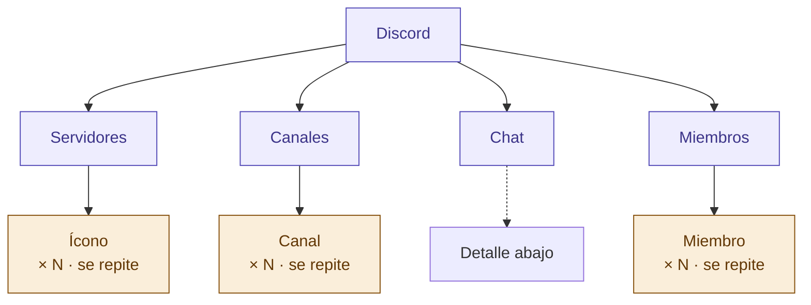

# Algoritmia 1 - Sesión 3: Repetir y descomponer

## 1. CajeroParqueadero

**Lógica:**

1. Se inicializan las variables total y carros en 0.
2. Se solicita el valor cobrado por el vehículo.
3. Se utiliza un ciclo Mientras que se repite mientras el valor sea diferente de 0.
4. Se acumula el valor ingresado en la variable total.
5. Se incrementa el contador carros en 1.
6. Se solicita nuevamente el valor del siguiente vehículo.
7. Cuando se ingresa 0, termina el ciclo.
8. Se muestran la cantidad de carros atendidos y el total recaudado.

**Ejemplo de ejecución:**

Valor del vehículo:

> 4000

Valor del vehículo:

> 8000

Valor del vehículo:

> 2000

Valor del vehículo:

> 0

Carros atendidos: 3

Total recaudado: $14000

**Tabla de traza:**

| Iteración | Valor | Total acumulado | Carros |
|---|---:|---:|---:|
| Inicial | - | 0 | 0 |
| 1 | 4000 | 4000 | 1 |
| 2 | 8000 | 12000 | 2 |
| 3 | 2000 | 14000 | 3 |
| Salida | 0 | 14000 | 3 |

**Resultados:**

| Concepto | Resultado |
|---|---:|
| Carros atendidos | 3 |
| Total recaudado | $14.000 |

---

## 2. ValidarPIN

**Lógica:**

1. Se inicializa el contador intentos en 0.
2. Se inicializa la variable lógica acceso en Falso.
3. Se solicita el PIN al usuario.
4. Se incrementa el contador de intentos.
5. Se compara el PIN ingresado con el PIN correcto (2580).
6. Si el PIN es correcto, la variable acceso cambia a Verdadero.
7. El ciclo Repetir termina cuando se obtiene acceso o se alcanzan tres intentos.
8. Se muestra el mensaje correspondiente según el resultado.

**Ejemplo de ejecución:**

Primer intento:

> 1234

Segundo intento:

> 4567

Tercer intento:

> 2580

Resultado:

> Bienvenido

**Resultados:**

| Intento | PIN ingresado | Resultado |
|---|---:|---|
| 1 | 1234 | Incorrecto |
| 2 | 4567 | Incorrecto |
| 3 | 2580 | Correcto |

---

## 3. Calificaciones

**Lógica:**

1. Se inicializan el acumulador suma, el contador aprobados y la bandera alguienPerdio.
2. Se inicializa la variable mayor en 0 y menor en 5.
3. Se utiliza un ciclo Para que se repite cinco veces.
4. Se solicita la nota de cada estudiante.
5. Se acumulan las notas en la variable `suma.
6. Si la nota es mayor o igual a 3, se incrementa el contador de aprobados.
7. Si la nota es menor a 3, la bandera alguienPerdio cambia a Verdadero.
8. Se comparan las notas para actualizar el valor mayor y menor.
9. Al terminar el ciclo, se calcula el promedio y se muestran los resultados.

**Ejemplo de ejecución:**

| Estudiante | Nota |
|---|---:|
| 1 | 3.5 |
| 2 | 2.8 |
| 3 | 4.9 |
| 4 | 3.0 |
| 5 | 4.2 |

**Resultados:**

| Concepto | Resultado |
|---|---:|
| Promedio | 3.68 |
| Aprobados | 4 |
| Nota más alta | 4.9 |
| Nota más baja | 2.8 |
| ¿Alguien perdió? | Sí |

---

## 4. Piramide

**Lógica:**

1. Se solicita la altura de la pirámide.
2. Se utiliza un ciclo Para para controlar las filas.
3. Se calcula la cantidad de espacios utilizando `n - fila`.
4. Se utiliza un ciclo Para para imprimir los espacios antes de los asteriscos.
5. Se calcula la cantidad de asteriscos mediante `2 * fila - 1`.
6. Se utiliza otro ciclo Para para imprimir los asteriscos.
7. Se realiza un salto de línea al terminar cada fila.
8. El proceso se repite hasta completar la altura ingresada.

**Ejemplo de ejecución:**

Altura de la pirámide:

> 4
   *
  ***
 *****
*******

**Tabla de traza:**

| Fila | Espacios | Asteriscos | Representación |
|---:|---:|---:|---|
| 1 | 3 | 1 |    * |
| 2 | 2 | 3 |   *** |
| 3 | 1 | 5 |  ***** |
| 4 | 0 | 7 | ******* |

**Resultados:**

| Concepto | Resultado |
|---|---:|
| Altura | 4 |
| Total de filas | 4 |
| Total de asteriscos | 16 |

---

## 5. FacturaRestaurante

**Lógica:**

1. Se inicializa la variable `subtota` en 0.
2. Se llama al subproceso LeerPedido() para solicitar los valores de los productos.
3. Se acumulan los valores ingresados hasta que el usuario introduzca 0.
4. Se llama al subproceso CalcularPorcentaje() para calcular el impuesto del 8%.
5. Se vuelve a utilizar CalcularPorcentaje() para calcular la propina del 10%.
6. Se llama al subproceso ImprimirFactura() para mostrar los valores calculados.
7. Se calcula el total sumando el subtotal, el impuesto y la propina.

**Subprocesos utilizados:**

- LeerPedido(): solicita los valores de los productos y acumula el subtotal.
- CalcularPorcentaje(): calcula un porcentaje sobre una cantidad determinada.
- ImprimirFactura(): muestra el subtotal, impuesto, propina y total.

**Ejemplo de ejecución:**

Primer producto:

> 25000

Segundo producto:

> 25000

Tercer producto:

> 12000

Finalizar pedido:

> 0

**Resultados:**

| Concepto | Valor |
|---|---:|
| Subtotal | $62.000 |
| Impuesto (8%) | $4.960 |
| Propina (10%) | $6.200 |
| Total | $73.160 |

---

## 6. Árbol de componentes

